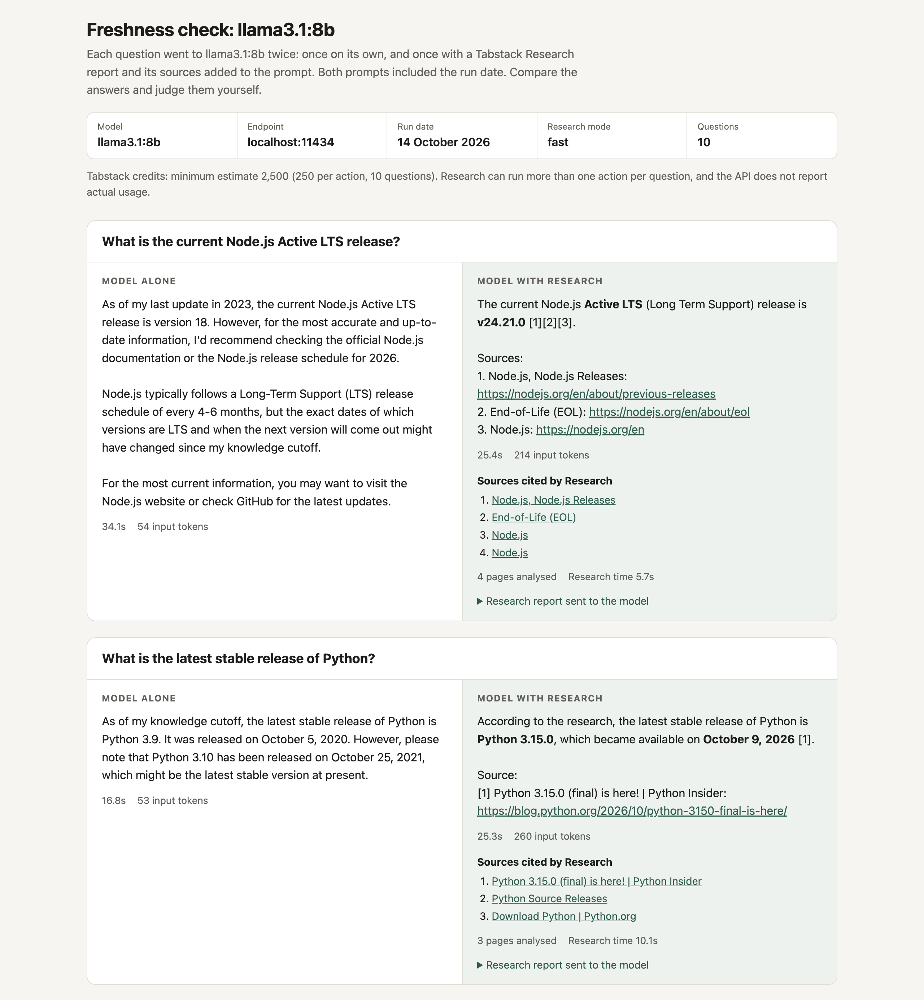

# freshness-check

`freshness-check` asks a model you run a set of questions whose answers keep changing, first on its own and then with a [Tabstack Research](https://docs.tabstack.ai/guides/research/) report added to the prompt. It writes an HTML report that puts both answers side by side, plus a JSON file with the same data.

## Quickstart

You need [uv](https://docs.astral.sh/uv/), a Tabstack API key, and a model running behind an OpenAI-compatible endpoint. This example uses [Ollama](https://ollama.com):

```sh
ollama pull llama3.1:8b
export TABSTACK_API_KEY="your-tabstack-key"

uvx --from git+https://github.com/juststeveking/freshness-check freshness-check \
  --model llama3.1:8b
```

The tool prints the credit estimate and asks before it sends anything. When it finishes, open `freshness-report.html`.

The full set of options:

```sh
freshness-check \
  --base-url http://localhost:11434/v1 \
  --model llama3.1:8b \
  --questions questions.txt \
  --out report.html
```

| Option | Default | Notes |
| --- | --- | --- |
| `--base-url` | `http://localhost:11434/v1` | Any OpenAI-compatible chat completions endpoint |
| `--model` | required | Model name as your runtime expects it |
| `--api-key` | `not-needed` | Or set `MODEL_API_KEY`. Local runtimes usually ignore it |
| `--questions` | built-in set | `.txt` or `.jsonl`, see below |
| `--mode` | `fast` | Research mode: `fast` or `balanced`. Balanced needs a paid plan |
| `--out` | `freshness-report.html` | The JSON file goes alongside with the same name |
| `--limit` | none | Run only the first N questions |
| `--yes` | off | Skip the cost confirmation prompt |
| `--research-timeout` | `60` | Seconds with no Research events before the call counts as failed |
| `--model-timeout` | `300` | Seconds to wait for each model response |
| `--context-window` | none | Your model's context window in tokens. Adds a note when a prompt looks larger |

The Tabstack key comes from `TABSTACK_API_KEY` only. The tool never writes it to the report, the JSON or the terminal.

## Runtime base URLs

| Runtime | `--base-url` |
| --- | --- |
| Ollama | `http://localhost:11434/v1` |
| LM Studio | `http://localhost:1234/v1` |
| llama.cpp server (`llama-server`) | `http://localhost:9931/v1` (older builds used port 8080) |
| vLLM | `http://localhost:8000/v1` |

These are the defaults in each runtime's docs as of October 2026. If you started the server on another port, use that.

## Using your own questions

A `.txt` file has one question per line. Blank lines and lines starting with `#` are skipped.

```text
What is the latest stable release of Go?
What is the current version of the HTML spec?
```

A `.jsonl` file has one JSON object per line. `expected` is optional. When you include it, the report shows it next to the question so you can compare.

```jsonl
{"question": "What is the latest stable release of Go?", "expected": "1.25"}
{"question": "What is the current version of the HTML spec?"}
```

The built-in questions cover release versions of Node.js, Python, Laravel, PHP, Rust, PostgreSQL, Ubuntu, Kubernetes, Astro and Ollama. They have no expected answers, because any value written down today goes out of date.

## Cost

Before it runs, the tool prints an estimate like this and asks you to confirm:

```text
10 questions in fast mode. Research bills per action (250 credits per action in fast mode)
and may run more than one action per question, so this is a minimum of 2,500 credits.
```

Balanced mode costs 350 credits per action. Figures come from [tabstack.ai/pricing](https://tabstack.ai/pricing). The Research API does not report the credits a call used, so the report shows the same minimum estimate and labels it as one. Use `--limit` to try a few questions first.

Questions run one at a time. If Tabstack returns a rate limit, the tool waits and retries once, then marks that question as failed and moves on.

## What the report shows



- A header with the model, endpoint host and port, run date, Research mode and number of questions.
- One card per question with two columns: "Model alone" and "Model with Research". Each answer shows the time it took and the input tokens that went into the model's context. Token counts come from the runtime's `usage` field, and are marked "est." when the runtime does not report them.
- Under the Research answer: the sources Research cited, the number of pages it analysed, the research time, and the research report the model received.
- A clear failure message when either path fails. The other path still shows its result.
- A note when the runtime reports far fewer input tokens than the prompt contains, which usually means it cut the prompt to fit its context window.
- The command to reproduce the run, with keys left out.

## Limitations

- **No scoring.** The report does not grade answers or pick a winner. You read both and judge. If the model alone gets an answer right, the report shows that.
- **Results depend on the date you run it.** The questions are about things that change, so a run next month can differ from a run today.
- **The Research path depends on the model following instructions.** The prompt asks the model to answer only from the research. If a model answers from its own knowledge instead, the "Model with Research" column shows that answer. Open "Research report sent to the model" in the report to compare.
- **Context windows.** The research report and sources go into the prompt in full. If your runtime's context window is smaller than the prompt, it may cut the prompt without an error. With Ollama, raise the window with the `OLLAMA_CONTEXT_LENGTH` environment variable or the model's `num_ctx` parameter.
- **Timings include model loading.** The first call to a local model often includes the time to load it into memory.

## Data handling

The tool sends each question to two places: your model endpoint (`--base-url`), and Tabstack Research. The Research report and its source URLs then go to your model endpoint as part of the second prompt. Nothing else leaves your machine, and the tool collects no telemetry. See [tabstack.ai/trust](https://tabstack.ai/trust) for how Tabstack handles data.

## Development

```sh
uv sync
uv run pytest
uv run ruff check
uv run ruff format --check
```

The tests use recorded Research streams and a fake model client. They make no network calls.

Both prompt templates live in [`src/freshness_check/prompts.py`](src/freshness_check/prompts.py) if you want to try different wording.

## Licence

MIT
